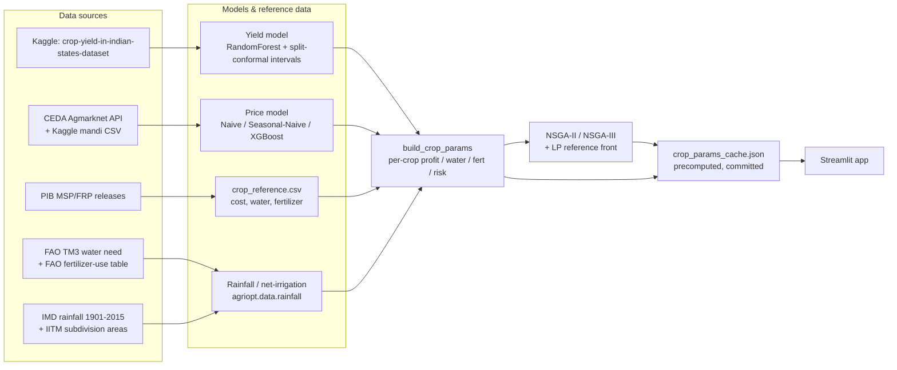

# AgriOpt

[](https://github.com/Dhwanitisshah/agriopt/actions/workflows/tests.yml)

**Live demo:** `https://agriopt-bmuud9kclfctcmxrb3abce.streamlit.app`

Maharashtra's farmers choose what to plant largely on habit and last year's prices, with no
systematic way to weigh profit against water use, fertilizer load, food-crop security, or
year-to-year risk. AgriOpt is a data-driven crop allocation tool for Maharashtra: it combines a
trained crop-yield model, a price forecasting model, and government reference data (cost of
cultivation, MSP/FRP, water need, fertilizer dose, rainfall) into a per-hectare economic profile
for 8 major crops (rice, wheat, jowar, soybean, cotton, sugarcane, tur, maize), then runs a
multi-objective optimizer (NSGA-II/NSGA-III, cross-checked against an exact LP reference) to
recommend how a farmer should split their land across those crops under their own land, water,
and food-security constraints. A Streamlit app exposes the recommendation, its trade-offs against
simpler baselines, a historical backtest, and the full evidence trail (model metrics, significance
tests, data sources) behind every number it shows.

## Architecture



The app never loads the ~528 MB trained yield model or the price model at request time. A
dedicated offline script (`scripts/40_build_cache.py`) calls the modeling layer once, precomputes
every scenario the app's UI can produce, and writes the result to a single committed JSON file
(`data/processed/crop_params_cache.json`) that the app reads on every request.

## Key results

Headline numbers below are pulled directly from `reports/results/RESULTS_INDEX.md`, the
consolidated results index spanning all phases of this project; see that file (and the
experiment-specific `.md` files it cites) for full detail and every caveat.

> **Regenerated Oct 2026 after the economics review** (backtest cost units, sugarcane economics, food-share
> counting, LP-polished recommendation, per-season current mix, Sigma-based risk, backtest information set, monthly
> water balance). Every number below comes from the regenerated `reports/results/*`; before/after for each is in
> [`reports/results/CHANGELOG_fixes.md`](reports/results/CHANGELOG_fixes.md). Caveats that apply throughout: the
> backtest has only **n=4 usable years** (2016-2019), costs are all-India per quintal x Maharashtra yield (so margins
> are largely set by MSP policy, not measured per state -- open item), and "current mix" B1 is the historical state
> crop mix run on a 10 ha farm.

**Decision backtest, 2016-2019 -- every baseline (mean realized profit per year, Rs, 10 ha; water-matched capture
ratio vs a perfect-foresight plan using the same water; profit per 1,000 m3 of water).** All crops planned on 1 May.

| strategy | default water: profit | capture | profit / 1,000 m3 | tight water (0.7x): profit | capture | profit / 1,000 m3 |
|---|---|---|---|---|---|---|
| B1 current mix | 229,479 | 0.66 | 2,181 | 229,479 (water-infeasible) | 0.66 | 2,181 |
| B1_SCALED (closest feasible mix) | 229,479 | 0.66 | 2,181 | 154,455 | 0.51 | 2,097 |
| B2 profit-max LP | **288,084** | 0.87 | 2,739 | **259,036** | 0.89 | 3,517 |
| B3 same profit, least water | 220,337 | 0.89 | 3,935 | 228,429 (3 of 4 yrs feasible) | 0.94 | 4,363 |
| **OURS** (NSGA-II + LP polish) | 230,769 | 0.87 | 3,714 | 200,645 | 0.88 | 3,951 |
| MODEL_B (risk-aware) | 259,420 | 0.86 | 3,553 | 197,695 | 0.81 | 3,489 |
| ORACLE (perfect foresight) | 339,253 | 1.00 | 3,802 | 295,022 | 1.00 | 4,094 |

Read it honestly: OURS is a **water-saving** plan, not a profit-maximising one -- at default water it ties the
current mix on profit (+Rs 1,290/yr, 2 of 4 years) while using 37.6% less water (1.7x the profit per m3); at tight
water it loses to the raw (water-infeasible) current mix by Rs 28,834/yr but beats the water-feasible B1_SCALED by
Rs 46,190/yr (3 of 4). B2, the plain profit-max LP, beats OURS in every year of both scenarios. Per-year deltas
(no p-values: four paired years cannot reject at 5%) are in `backtest_summary_v2.md` section 5. Perfect foresight
would add 14-18% over B2, and knowing the realized **yields** alone closes ~2/3 of that gap versus ~1/3 for prices
(`backtest_skill.md`) -- the yield forecast is the weak link, see the yield row below.

| Result | Headline number | Caveat |
|---|---|---|
| Optimizer vs current mix (E3.1, 10 ha, market prices) | At current water OURS earns **+51.6%** profit with **35.7% less water** than the current mix (tight water: +13.8% with 52.4% less). B3 matches B1's profit with **58.5% less water** (tight/market). B2 averages +65.1% over six scenarios on 3.2 crops | B1 uses all its land (10/10 ha per season) and is food-feasible (45% food share), but violates the water budget in the two tight scenarios, so "vs B1" there is vs an infeasible reference. The recommendation is the exact LP optimum at its own water and fertiliser (NSGA-II alone was 0.1-2.0% below it). B2 concentrates in ~3 crops. |
| Risk-aware Model B vs Model A (current water) | Profit +17.0%, water +21.2%, fert -1.8%, **rupee risk +7.0%** but risk per rupee of profit **-8.6%** (0.254 vs 0.278) | Model B now optimises risk per rupee of profit, so idling land cannot look safe (the absolute-rupee objective cut profit by half in a risk-heavy test). Reported profit risk is sqrt(x'Sigma x) over 18 years of revenue history; the old independent-crops figure understated it ~5x. Its sugarcane allocation depends on the FRP-price artefact flagged in `risk_strategies.md`. |
| Information ablation (profit-max planner, loss vs full information) | Tight water: mean-price 14.4%, no-cost-data 12.3%, no-ML-yield 11.3%, MSP-price 11.3%. Current water: MSP-price 12.0%, mean-price 8.9%, no-cost 8.9%, no-ML-yield 4.3% | Single model family; loss for the ML yield is smaller than for prices at current water. Previously no-ML-yield cost 0%, an artefact of the sugarcane bug. |
| Region comparison, **equal water budget** (net irrigation, normal rain, 54,532 m3 everywhere) | OURS profit: Konkan Rs 273,010 > Maharashtra 258,265 > Madhya 244,796 > Vidarbha 239,686 > Marathwada 224,101 (Konkan +22% over Marathwada). At 0.7x water in a real dry year Marathwada falls to -11.2% vs the current mix | Replaces the per-region-budget comparison, which handed the rainier region a smaller budget. Net irrigation is now a monthly water balance with a real dry year (1986 for Marathwada); the FAO seasonal need is spread uniformly over the season (assumption). |
| Yield model on the 8 decision crops (one step ahead, 2016-2019) | RandomForest beats a last-3-year state-mean baseline on only **3/8 crops** (rice, wheat, soybean); mean MAPE 19.4% vs 19.7% | Loses to the baseline on jowar, cotton, sugarcane, tur and maize, and to the best of three naive baselines on 7/8. n=4 years per crop. The old pooled Maharashtra R² (0.94) mixed tonnes, bales and milled-rice units and is dropped. |
| Yield model significance (Wilcoxon, Maharashtra test, n=152) | RandomForest significantly beats XGBoost (p=0.009) and Ridge (p<0.001) | The 152 paired errors pool all crops in native units (large-valued crops dominate) -- a pooled screen, not a decision-crop result. RF vs Baseline-Mean is **not** significant (p=0.469). |
| Price model significance (panel Diebold-Mariano, month-clustered) | Naive vs XGBoost is **not significant** at any horizon (p = 0.076 / 0.081 / 0.071 at h = 3 / 6 / 12; block bootstrap 0.065 / 0.038 / 0.109). Naive beats Seasonal-Naive at h = 3 and 6 | Replaces a test that stacked the 7 crops as independent (p = 0.031 at h=6, 0.020 at h=12). The effective n is the 36-45 origin months; at h=6 the bootstrap and the HLN test disagree -- borderline. |
| Seed robustness (10 seeds) | Hypervolume NSGA-II 0.586 +/- 0.007, NSGA-III 0.572 +/- 0.008. Recommended allocation moves 0.18 ha per crop across seeds for NSGA-II (polished) but **0.70 ha for NSGA-III** (7% of the farm) | Risk-aware plans are noticeably less reproducible across seeds than the standard plan; n=10 seeds. |
| Yield conformal intervals (90% nominal) | Overall Maharashtra empirical coverage = 0.941 (mean width 2.53 t/ha) | Per-crop coverage varies (cotton/tur measured at 0.75) -- always check per-crop before trusting one crop's interval. |

## Data sources

- **Yield**: Kaggle [crop-yield-in-indian-states-dataset](https://www.kaggle.com/datasets) (APY-style: area/production/yield by state/crop/season/year)
- **Prices**: [CEDA Agmarknet API](https://api.ceda.ashoka.edu.in/documentation/) (primary, mandi modal prices); Kaggle mandi CSV (secondary, few crops)
- **Cost of cultivation & MSP**: PIB / Dept. of Agriculture & Farmers Welfare Kharif/Rabi Marketing Season price releases (see `data/reference/msp_history.csv`'s `source_url` column for the exact PDF cited per crop-year, e.g. `desagri.gov.in/wp-content/uploads/...MSP-kharif-2016-17.pdf`)
- **Sugarcane price**: CCEA Fair and Remunerative Price (FRP), not MSP -- see `admin_price_rs_per_qtl` in `data/reference/crop_reference.csv`.
  The farmer is paid FRP minus harvesting & transport (H&T), so the model uses FRP − ₹75/qtl
  (₹750/t H&T deducted in the Pune/Nashik divisions in 2023-24, per [ChiniMandi](https://www.chinimandi.com/sugarcane-pricing-policies-an-analysis-of-maharashtras-frp-formula/));
  see `price_deduction_rs_per_qtl`.

## How per-hectare economics are computed

Every row the optimizer sees -- live app, cache, and backtest -- is built by one function,
`agriopt.optim.params.economic_row`, per hectare **per land-year**:

- `cost_ha = cost_rs_per_qtl × yield_qtl_ha` (cost is published per quintal; never mix the units).
- `price` = farm-gate price (gross MSP/FRP/mandi price minus `price_deduction_rs_per_qtl`).
- Crops whose cycle is longer than 12 months tie up land for longer than one land-year, so
  yield, water and fertilizer are scaled by `12 / cycle_months`. Sugarcane uses 15 months, a
  middle value for Maharashtra's adsali (~18), pre-seasonal (~15) and suru (~12) plantings.
- Sugarcane's profit risk is its measured revenue CV (0.097, yield × FRP over 21 years), not 0.
- The food-security minimum counts **season-hectares**: a food crop counts once per season it
  occupies, against a capacity of 2 × land, so `food_share` is always in [0, 1].

Effect on the cached presets: before the fix sugarcane supplied 59-81% of every recommended
plan's profit; it is now 3-53% (median 31%) in the standard plans. It is still the highest-profit
crop per hectare (₹61k net vs ₹24k for rice), and in the *risk-aware* plans for the medium and
large presets it supplies 75-78% of profit -- a concentration to treat with suspicion, because
sugarcane's measured price risk is an FRP artefact and its cost is an all-India per-quintal
figure (open item: state-wise cost of cultivation).

Other conventions the numbers depend on (details in `reports/results/CHANGELOG_fixes.md`):
the recommended plan is the exact LP optimum at its own water and fertiliser (NSGA-II alone
leaves 0.1-2% of profit on the table); the current-mix baseline B1 is built per season so it uses
the farm's land; reported profit risk is sqrt(x'Σx) from the revenue covariance; and net
irrigation is the sum of monthly water deficits.
- **Crop water need**: FAO Irrigation and Drainage Paper (TM3) crop water requirement tables
- **Fertilizer dose**: FAO (2005) *Fertilizer use by crop in India*, Table 13 (soybean: ICAR-IISS recommended dose)
- **Rainfall**: Kaggle `rajanand/rainfall-in-india` (IMD sub-divisional monthly rainfall, 1901-2015)
- **Subdivision areas** (for the area-weighted Maharashtra state-wide average): IITM (Indian Institute of Tropical Meteorology, Pune) subdivisional rainfall metadata, [tropmet.res.in/data/data-archival/rain/iitm-subdivrf.txt](https://www.tropmet.res.in/data/data-archival/rain/iitm-subdivrf.txt)

## Reproduce

```powershell
python -m venv .venv
.\.venv\Scripts\Activate.ps1
pip install -r requirements.txt
pip install -e .
```

Fetch data (requires Kaggle auth + a CEDA API key in `.env`, see `.env.example`):

```powershell
.\scripts\00_download.ps1
python scripts\01_audit_yield.py
python scripts\03_fetch_ceda_prices.py
python scripts\02_audit_prices.py
```

Train models and run the core experiments, in order (each script's own docstring documents its
inputs/outputs; skip ahead only if you already have that script's output committed/cached):

```powershell
python scripts\10_train_yield.py
python scripts\20_train_price.py
python scripts\30_run_optimizer.py
python scripts\31_run_risk.py
python scripts\50_ablation.py
python scripts\60_backtest.py
python scripts\61_backtest_v2.py
python scripts\62_backtest_skill.py     # look-ahead, no-sugarcane and partial-foresight diagnostics
python scripts\70_water_basis_net.py
python scripts\71_water_region.py
python scripts\90_price_significance.py
python scripts\91_yield_significance.py
python scripts\92_conformal.py
python scripts\93_loso.py
python scripts\94_seed_robustness.py
python scripts\95_yield_decision_crops.py   # yield model on the 8 decision crops vs naive baselines
```

`scripts\42_patch_cache_economics.py` re-derives the cached economics without the models;
`scripts\migrations\` holds one-off data migrations (already applied to the committed files).
`tests/test_results_not_stale.py` re-solves the cheap LP rows (B1/B2/B3) from the committed cache
and fails CI if `optim_strategies*.csv` no longer matches -- re-run scripts 30 and 70 if it does.

Build the app's cache (the only thing the app itself ever reads) and run it:

```powershell
python scripts\40_build_cache.py
streamlit run app\streamlit_app.py
```

Headless smoke test (no browser): `python scripts\smoke_e2e.py`

Run tests:

```powershell
pytest -q                       # full suite (needs the full gitignored dataset + trained models)
pytest -m "not needs_data" -q   # CI's subset -- only the committed cache + pure-function tests
```

## Deploying (Streamlit Community Cloud)

The app only needs the slim `requirements-app.txt` (pinned versions; no xgboost/shap/scikit-learn
-- those are training-only and never imported by the app's own live path) plus the committed
`data/processed/crop_params_cache.json`. `.streamlit/config.toml` sets `headless = true` and a
theme. See `requirements.txt` for the full dev/training dependency set.

## Limitations & future work

- **n=4 backtest years** (2016-2019): Maharashtra's yield dataset has zero rows for 2020, so every
  realized-outcome backtest metric (profit, win counts, per-year deltas) is computed on 4 years, not the
  intended 5 -- low statistical power, read as directional only.
- **State-level, not district-level**: every model and the optimizer operate on Maharashtra-wide
  (or, since Phase 8.1, IMD-subdivision-wide) figures; a real deployment would need district- or
  even farm-level cost/yield/water data to be actionable for an individual farmer.
- **MSP-derived, not published, cost-of-cultivation** for most crop-years: `cost_a2fl_rs_per_qtl`
  in `data/reference/msp_history.csv` is largely index-derived rather than a directly published
  CACP figure -- see that file's `provenance` column.
- **Rice percolation/land-preparation water is a documented, uncited gap**: `net_irrigation_mm()`
  adds a citable FAO figure for puddled-rice saturation water (`RICE_EXTRA_MM`), but explicitly
  does NOT add percolation/seepage losses, which are highly soil-type dependent and have no single
  citable figure without inventing a soil assumption this repo has no data to support (see
  `docs/water.md`, Phase 8.1 section 3).
- **Sugarcane's low measured price risk is an FRP artifact**, not genuinely low agronomic risk
  (a fixed administered price has zero month-to-month variance by construction) -- the risk-aware
  model's sugarcane allocation is sensitive to this assumption (see `reports/results/risk_strategies.md`).
- **Cost margins are mostly set by policy**: cost per quintal is all-India (derived from MSP margins for most
  crops), so jowar, soybean and cotton carry an identical margin by construction. A state-wise
  CACP cost of cultivation (Rs/ha) for Maharashtra is the single most valuable missing input.
- **The yield model does not clearly beat a 3-year average** for most decision crops (see Key results), while
  yield error is the largest source of regret in the backtest.
- Future work: district-level yield/cost data, state-specific (not all-India) cost of cultivation,
  a citable percolation/seepage figure for puddled rice, and extending the backtest window past
  2020 once more recent Maharashtra yield data becomes available.

## Tests

```powershell
pytest -q
```

CI (`.github/workflows/tests.yml`) runs two jobs: the full requirements with the cache-only subset
(`pytest -m "not needs_data"`), and the deployed stack -- only `requirements-app.txt`, pinned -- with the
tests, headless smoke test and tab check that need nothing but the committed cache.

## Layout

- `src/agriopt/` — importable package (config, data loaders/cleaners, CEDA client, models, optimizer)
- `scripts/` — one-off download/fetch/audit/train/experiment scripts, plus `40_build_cache.py` (app cache) and `smoke_e2e.py`/`check_app_tabs.py` (headless demo smoke tests)
- `data/raw/` — downloaded, gitignored
- `data/raw/prices_ceda/` — cached raw CEDA API responses, gitignored
- `data/processed/` — cleaned parquet (gitignored) + `crop_params_cache.json` (app's only data input, **committed** via a `.gitignore` negation)
- `data/reference/` — hand-curated reference tables, committed
- `docs/formulation.md` — optimization problem formulation
- `docs/units.md` — Yield -> quintals-of-marketed-product unit conversions
- `docs/water.md` — total-need vs net-irrigation water accounting, region weighting (Phase 8/8.1)
- `docs/backtest.md` — decision backtest methodology and MSP/cost sourcing
- `reports/results/RESULTS_INDEX.md` — one row per experiment across every phase, with headline number + caveat
- `app/streamlit_app.py` — Streamlit demo entry point; `app/pipeline.py`/`app/data.py` hold non-UI logic; `app/components/` holds per-tab UI
- `requirements.txt` — full dev/training dependencies; `requirements-app.txt` — slim, pinned, app-only subset for deployment
